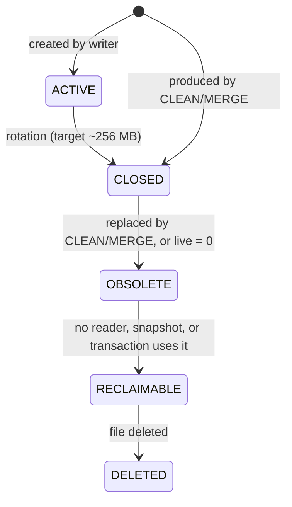

# 03 — Storage

> **Source:** ‘Append-only storage’, ‘Segments’, ‘Segment metadata’, and ‘Record versions’ of the
> [specification](specifica/specifica-originale.md).
> **Modules:** M01 Storage Engine, M03 Segment Manager, M04 Segment Metadata Manager.
> **Decisions:** [ADR-0013](adr/0013-log-structured-segmento-active-come-log.md) (the
> ACTIVE segment is the data log), [ADR-0037](adr/0037-lotto-sigillato.md) (sealed batches),
> [ADR-0039](adr/0039-cornice-unica-dei-record.md) (records),
> [ADR-0040](adr/0040-manifest-a-record-unico.md) (manifest and states),
> [ADR-0042](adr/0042-tombstone-e-indice-dei-vivi.md) (tombstones). Formats in
> [formati-su-disco.md](formati-su-disco.md#segmento).

## Append-only

A Serie's storage is append-only: records already written to segments MUST NOT be
modified in place (INV-S1). Updating a document means writing a new version;
deleting it means writing a tombstone. Previous versions remain on disk until
[compaction](07-compaction.md) reclaims them.

<a id="il-segmento-active"></a>

## The ACTIVE segment

Every Serie has **exactly one** `ACTIVE` segment, which is the only mutable segment (INV-S2,
INV-S3).

When a segment ceases to be ACTIVE:

- it becomes immutable;
- it can no longer be reopened for writing;
- it can no longer receive new records (INV-S4).

New writes always go to a new ACTIVE segment (INV-S5).

<a id="dimensione-dei-segmenti"></a>

## Segment size

- Normal target/maximum for a segment **created by the writer**: approximately **256 MB**, configurable
  per Serie.
- The limit applies only to normal creation by the writer. Segments produced by
  compaction have **no** size requirements.

Example from the specification:

```
S017 = 256 MB (live 20 MB, dead 236 MB)
  ↓ CLEAN
S042 = 20 MB, immutable

new writes
  ↓
S043 = ACTIVE          ← never “fill” S042 to 256 MB
```

<a id="stati-del-segmento"></a>

## Segment states

```
ACTIVE → CLOSED → OBSOLETE → RECLAIMABLE → DELETED
```

| State | Writable | Readable | Meaning |
|---|---|---|---|
| `ACTIVE` | yes | yes | the only segment that receives writes |
| `CLOSED` | no | yes | immutable, referenced by the current index |
| `OBSOLETE` | no | yes | replaced by compaction; still readable by already active readers/snapshots |
| `RECLAIMABLE` | no | — | no longer used; awaiting deletion |
| `DELETED` | — | — | file deleted |



Transitions are one-way: no state returns to ACTIVE.

> **Decided ([ADR-0018](adr/0018-control-log-manifest-swap.md), [ADR-0040](adr/0040-manifest-a-record-unico.md))** — The specification does not name the state of a segment produced by compaction.
> Since it is immutable from creation, it is treated here as `CLOSED` from the swap onward. Before
> the swap, the file is under construction and invisible (INV-C7): this is not a model state, but
> a `.tmp` file that recovery discards. The only **durable** property is a segment's membership
> in the set recorded in the manifest (`ACTIVE`, `CLOSED`, removed): `OBSOLETE`,
> `RECLAIMABLE`, and `DELETED` are in-memory states of a removed segment. An `ACTIVE` lives
> within a single process: after a restart, it is closed at its valid length and a new one
> is created (INV-A9).

> **Proposed** — For `live = 0`, the specification calls for ‘DELETE directly’. Here this means:
> no copying and no output segment, but the segment still passes through
> `OBSOLETE → RECLAIMABLE → DELETED`, so the reclaim conditions (INV-R1) are checked in
> a single place.

## Segment metadata

Each segment has metadata for at least:

| Field | Description |
|---|---|
| `segment-id` | segment identifier |
| `record-count` | total number of records |
| `live-records` / `dead-records` | counts by classification |
| `total-bytes` / `live-bytes` / `dead-bytes` | sizes by classification |
| state | one of the states above |
| creation time | time of creation |
| close time | time of closure (reference for the 50 s rule, see [07](07-compaction.md)) |
| version/epoch | if applicable |
| references | what recovery and snapshot management need |

Metadata are **derived data (a cache)** and MUST NOT be the sole source of truth (INV-S6).
They must be rebuildable, verifiable, and correctable from the WAL, data, and index.

Practical consequence: an incorrect `dead-bytes` counter may lead to a poor choice of
compaction candidate, but can never cause data loss, because the choice of records to
copy is based on the index and snapshots, not the counters.

<a id="classificazione-delle-versioni"></a>

## Version classification

| Class | Definition |
|---|---|
| `LIVE` | version reachable from the current index |
| `SNAPSHOT-LIVE` | no longer current, but still required by an active snapshot |
| `DEAD` | reachable by neither the current index nor any active snapshot |

A `DEAD` record may be reclaimed only when there are no remaining references from:

- the current index;
- active snapshots;
- transactions requiring that version.

Classification is dynamic: a `LIVE` version becomes `SNAPSHOT-LIVE` or `DEAD` when the
document is updated, and `SNAPSHOT-LIVE` becomes `DEAD` when the last snapshot that sees
it ends.

> **Decided (QA-15 → [ADR-0042](adr/0042-tombstone-e-indice-dei-vivi.md))** — A tombstone is itself a record: the specification does not say when compaction
> may discard it. It is discarded when superseded by a newer version or when no other
> segment can contain an older record for the same key (INV-C11); the in-memory index
> contains only live documents.

<a id="questioni-decise-che-toccano-lo-storage"></a>

## Decided questions affecting storage

- **QA-01** ([ADR-0014](adr/0014-formato-record-documento-id.md), [ADR-0039](adr/0039-cornice-unica-dei-record.md)) — record format (header, checksum, document encoding).
- **QA-02** ([ADR-0013](adr/0013-log-structured-segmento-active-come-log.md)) — WAL/segment relationship: is the data written twice, or is the ACTIVE segment
  populated in a way that allows early WAL truncation?
- **QA-04** ([ADR-0018](adr/0018-control-log-manifest-swap.md), [ADR-0040](adr/0040-manifest-a-record-unico.md)) — where the authoritative set of a Serie's segments is recorded (manifest).
