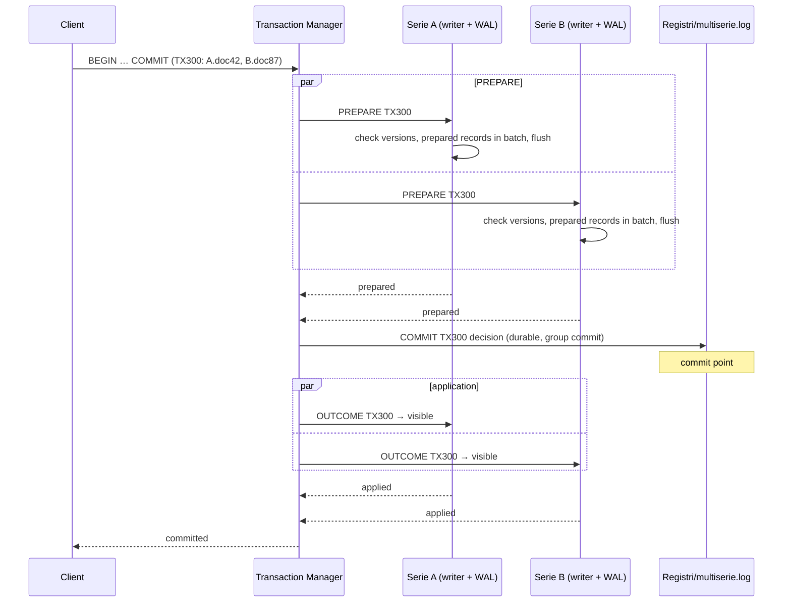

<a id="05--transazioni"></a>

# 05 — Transactions

> **Source:** ‘Single-Serie transactions’ and ‘Multiseries transactions’ of the
> [specification](specifica/specifica-originale.md).
> **Modules:** M09 Transaction Manager, M10 Multiseries Transaction Log Manager.
> **Decisions:** [ADR-0020](adr/0020-csn-snapshot-isolamento.md) (CSN, isolation),
> [ADR-0038](adr/0038-orizzonte-di-visibilita.md) (version is the CSN; horizon),
> [ADR-0021](adr/0021-2pc-intenti-outcome.md) (no-wait intents, presumed abort),
> [ADR-0041](adr/0041-multiserie-segmenti-autosufficienti.md) (self-contained segments,
> acknowledgment after publication). Flows in [architettura.md](architettura.md#transazioni).

There are two distinct paths. Which one applies depends only on how many Serie the
transaction **modifies**.

| | Single-Serie | Multiseries |
|---|---|---|
| Serie modified | 1 | ≥ 2 |
| Logs used | only the Serie WAL | WAL of each participating Serie + `Registri/multiserie.log` |
| Coordination | Serie logical writer | 2PC-like protocol |
| Conflict detection | optimistic version checking | (see QA-07) |

<a id="transazioni-single-series"></a>

## Single-Serie transactions

A transaction involving a single Serie:

- uses only the Serie WAL;
- does NOT write to `multiserie.log` (INV-T1);
- is serialized by the Serie's logical writer;
- uses optimistic version checking for conflicts on the same document.

```
doc42 = version 18
TX101 reads v18
TX102 reads v18
TX101 commit → v19
TX102 checks expected-version = 18 → conflict → abort/retry
```

> **Decided ([ADR-0038](adr/0038-orizzonte-di-visibilita.md), amending the example)** — A
> document's version is the **CSN** of the commit that produced it: numbers increase but are
> not consecutive (for example, `1042 → 1077`, rather than `v18 → v19`). `expected-version` is
> a CSN; zero means ‘the document must not exist’. A CSN is never reused, even after
> deleting the document (INV-M5).

Version checking MUST be **atomic with respect to applying the change** by the Serie
writer (INV-T2). Because only the writer mutates the Serie, ‘check and apply’ executed
inside the writer are atomic by construction, without per-document locks.

> **Decided (QA-09 → [ADR-0020](adr/0020-csn-snapshot-isolamento.md))** — The specification discusses conflicts ‘on the same document’ (write-write).
> It defines neither the resulting isolation level (snapshot isolation? read-set validation
> too?) nor behavior with respect to write skew.

<a id="transazioni-multiserie"></a>

## Multiseries transactions

A transaction modifying documents in multiple Serie is multiseries. All its changes
share **a single TXID** (INV-T5).

<a id="protocollo"></a>

### Protocol

Equivalent to two-phase commit:

1. `BEGIN`
2. `PREPARE` on participants
3. flush/fsync of participating WALs according to the durability level
4. durable recording of the decision in `multiserie.log`
5. `COMMIT` or `ABORT`
6. application/visibility of the decision on participants



> **Decided ([ADR-0041](adr/0041-multiserie-segmenti-autosufficienti.md))** — The client receives
> `committed` **after** the outcome has been applied in memory on all participants
> (INV-V5), so every read following acknowledgment sees the transaction. The commit point
> remains the durable decision. There is no PREPARE record: prepared records are made
> atomic by their batch's SEAL.

**Commit point.** The `COMMIT` decision MUST be durable in `multiserie.log` before the
transaction is considered definitively committed (INV-T3). Before that point, the transaction
can still abort; afterward, it MUST be completed on all participants, including across a
crash (INV-T4).

If a participant cannot prepare (version conflict, error), the decision is
`ABORT`.

### `multiserie.log`

- It is the *transaction decision log*: it records decisions, **not data**. Data reside in the
  Serie WALs.
- One file per Archivio, in `Registri/` (INV-W2). No per-transaction files.
- It contains only COMMIT decisions: with *presumed abort*, an abort is not recorded
  ([ADR-0041](adr/0041-multiserie-segmenti-autosufficienti.md)).
- It uses group commit where appropriate.
- It is NOT a global data WAL (INV-W1).

### Recovery

After a crash, the Recovery Manager:

1. reads `multiserie.log`;
2. identifies prepared/incomplete transactions;
3. determines the definitive decision;
4. completes `COMMIT` or `ABORT` on the participating Serie WALs.

> **Decided ([ADR-0021](adr/0021-2pc-intenti-outcome.md))** — Recovery decision rule (*presumed abort*): a transaction that appears
> PREPARED in one or more WALs but has **no** durable `COMMIT` decision in `multiserie.log`
> is aborted. This is the only rule consistent with INV-T3: without a durable decision,
> the transaction was never committed, so no client can have received acknowledgment.

<a id="questioni-decise-e-rischi"></a>

## Decided questions and risks

The multiseries part is where the specification leaves the most degrees of freedom, and is
one of the main topics of the [evaluation](valutazione/analisi-critica.md).

- **QA-06** ([ADR-0020](adr/0020-csn-snapshot-isolamento.md)) — Who assigns the TXID and how to obtain an Archivio-wide commit order,
  required for a consistent multiseries snapshot.
- **QA-07** ([ADR-0021](adr/0021-2pc-intenti-outcome.md)) — What concurrent readers and writers see on a document in PREPARED state,
  between prepare and the decision. The Serie writer cannot stop and wait for the
  decision, otherwise the entire Serie stalls (contrary to INV-P3).
- **QA-08** ([ADR-0021](adr/0021-2pc-intenti-outcome.md)) — When a decision may be forgotten and how `multiserie.log` is truncated.
- **QA-09** ([ADR-0020](adr/0020-csn-snapshot-isolamento.md)) — Isolation levels.
- Related risks: RSK-05, RSK-06 in the [risk register](valutazione/registro-rischi.md).
