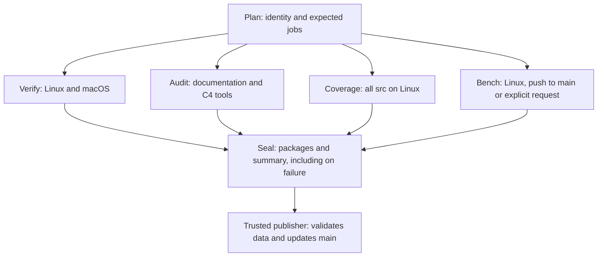

<a id="ci-e-statistiche-della-versione-corrente"></a>

# CI and current-version statistics

> **Proposal — 2026-10-16.** Implementable design; active CI is not
> replaced by this document. Author-confirmed constraints: GitHub
> runners only and results in a folder on `main`, with automatic commits.
> Hosted-runner performance remains exploratory measurement.

Contract is simple: **every number identifies exactly the code,
method, and environment that produced it**. Missing metric
exposes a state, never zero or a previous result.

References: [evidence register](../valutazione/registro-delle-prove.md),
[benchmarks](../13-benchmark.md), [C4 collection](raccolta-comandi.md),
[ADR-0027](../adr/0027-dipendenze-e-test.md), REQ-VAL-001,
REQ-AFF-005, and REQ-AFF-012. Design concerns C4 tools;
changes neither database formats nor requirement states.

<a id="1-punto-di-partenza"></a>

## 1. Starting point

Local-code survey `8ebca63f8649908e1a23b758928fa9c5c4274b00`:

| Existing item | Design consequence |
|---|---|
| `.github/workflows/ci.yml`: Linux/macOS `make check`, plus documentation job | Retain product verification on both systems; eliminate duplicate platform-independent checks |
| Local SBCL 2.6.9 action, Linux with checksum; macOS through updated Homebrew | Same declared version does not mean identical installation; pin distribution, digest, and recipe on macOS too |
| `record-command.lisp`: environment, argv, before/after blobs, output, outcome | Reuse original register; add explicit output path and CI metadata |
| ASDF lists suites, each owning its runner and registration | Introduce one catalog and per-test result protocol; no counts from `ok` lines |
| `run-spikes.lisp`: ten experiments, structured results and failures | Reuse experiments; distinguish verification, measurement, model, and unsupported functionality |
| `foundation-coverage.lisp`: selected scopes and HTML | Add complete campaign on current code and numeric output; overlapping scopes must not be summed |
| `get-resolver-coverage.lisp`: numerators/denominators and mark checks | Reuse uniqueness and reconciliation checks in general adapter; retain internal format bound to toolchain |
| Existing compression, hashes, and C4 collector | Compose these tools; exclude caches and rebuildable views from persistent archive |

Old campaigns in `spikes/results/` are historical evidence. Not
a database from which to extract current-version numbers.

<a id="2-identità-della-versione"></a>

## 2. Version identity

Each campaign preserves these identities without conflating them:

| Field | Meaning |
|---|---|
| `tested_sha` | `git rev-parse HEAD` of checkout actually compiled |
| `source_id` | SHA-256 of canonical inventory of all tracked files, excluding **only** `spikes/results/ci/` |
| `policy_id` | Digest of catalog, test selection, and measurement methods |
| `run_id`, `run_attempt`, `job_id`, `profile` | Run identity and any repetition |
| `publisher_sha`, `publication_parent` | Only in publication receipt: publisher code and results-commit parent; not part of measurement identity |

`source_id` inventory contains paths, Git modes, and blobs, sorted by
path bytes; UTF-8 encoding and NUL framing fixed by schema
version, object-ID format declared. Includes tests, corpus, Unicode,
ASDF, tools, workflows, documentation, and historical fixtures used by
checks. Preserve inventory as well as digest. New or deleted file
changes identity; symlinks and submodules require explicit policy.

Producer checks identity and tree before and after test; dirty
or changed checkout makes result unattributable. No download or
generation changes inputs: outputs live under `spikes/out/`
or runner temporary directory.

In PRs also preserve `head_sha` and `base_sha`: for
`pull_request` event, default checkout tests synthetic merge. Do not
label measurements as testing PR head alone.
`tested_sha` checked on checkout, not inferred from branch name
or `head_sha` field of later event.
([GitHub event semantics](https://docs.github.com/en/actions/reference/workflows-and-actions/events-that-trigger-workflows#pull_request).)

<a id="commit-automatici-dei-risultati"></a>

### Automatic results commits

If `A` contains measured code and `B` adds only results,
`A` and `B` have same `source_id`; record retains `tested_sha=A`.
View for `B` says "sources identical to those tested in A," without
inventing compilation of `B`. Change outside excluded prefix
requires new measurements, even documentation-only: conservative choice.

Excluded prefix is data only. No ASDF file, script, or
configuration may be loaded from it as code. CI-archive checking
separate from historical-fixture checking: new archive verified
in full by publisher before publication, without
reexamining every preceding run at every product commit.

<a id="3-due-workflow-un-solo-catalogo"></a>

## 3. Two workflows, one catalog



`ci.yml` produces evidence with `contents: read`. Catalog is sole source
for suites, profiles, platforms, metrics, units, methods, and expected jobs.
ASDF and local CLI consume same catalog; a check rejects
missing, unknown, or duplicate suites. Even smoke tests without
registry have explicit ID and adapter.

| Job | Frequency | Responsibility | Proposed initial timeout |
|---|---|---|---:|
| `plan` | Every PR/push/request | Identity, static inventory, expected matrix, profiles | 10 min |
| `verify` Linux/macOS | Every PR/push/request | Clean warning-free compilation, all expected suites, native checks | 30 min each |
| `audit` Linux | Every PR/push/request | Lint and self-tests, trace/links, C4 tools, historical fixtures, ten `--check` spikes | 30 min |
| `coverage` Linux | Every PR/push/request | Instrumented recompilation and tests from same catalog; complete `src/` denominator | 30 min |
| `bench` Linux | Every code push to main; PR/manual on request | Bounded serial quantitative profile, without coverage instrumentation | 20 min |
| `seal` | Always, including after producer errors | Expected/observed comparison, completeness, manifest, and upload | 10 min |

Design budgets, to validate on first runs. Child timeout
lower than job timeout, with margin for termination, record closure,
and upload. No unbounded wait or enumeration.

`make check` remains full local verification; CI subsets
must have same union of obligations. Separation eliminates no
currently-required check. Operating-system-dependent product tests
remain on both platforms; initial quantitative coverage and
exploratory measurements explicitly Linux.

Independent jobs parallel; benchmarks in fresh processes and serial within
their own VM. No performance measurement concurrent with build, hashing,
coverage, or compression in same VM. No automatic retries to
turn an intermittent test green: rerun preserves new attempt.

Updated PR may cancel previous run; reconciler
preserves canceled state. Pushes to main not canceled to
make room for new SHA. Do not use publisher-global concurrency
as reliable queue: default rules may replace
pending runs. ([GitHub concurrency](https://docs.github.com/en/actions/concepts/workflows-and-actions/concurrency).)

<a id="4-quali-statistiche"></a>

## 4. Which statistics

Catalog assigns each metric stable ID, domain, unit, method,
origin, availability, and mandatory profile. "All" means every
entry has attributable value or explicit absence reason.

| Family | Recorded data | Authoritative source |
|---|---|---|
| Code | Files/bytes/physical lines per module and category; ASDF components; orphan files | SHA's Git inventory; C4 lexer for categories, without evaluating forms |
| Compilation | Outcome, warnings/style-warnings, seconds, FASL bytes | Recorder and compiler boundary |
| Tests | Planned, started, passed, failed, not run; duration and condition per ID | Runner events, not stdout |
| FI, concurrency, models | Named cases, seeds, workers, budgets, outcomes, and expected rejections | Explicit test parameters and events; not inferred from name |
| Mutations | Baseline, valid/not-applicable mutants, compilation, detected/survived/inconclusive | Child protocol; dead worker does not count as detected mutant |
| Coverage | Numerators and denominators per file/module; SBCL lines, branches, and forms; uninstrumented files | SB-COVER and toolchain-bound adapter |
| Traceability | Requirements by state/class, missing references; links to actually-executed tests | Requirement database and checker report |
| C4 quality | Lint violations, broken links, inconsistent matrix, recognized negative cases | Checker with structured output |
| Memory and GC | Bytes consed, collections, CPU/wall GC time, buffer memory, RSS where observable | Declared measured window, SBCL/OS counters |
| Performance | Operations and bytes, elapsed time, throughput, samples/histograms, supported quantiles | Current-workload harness |
| I/O | Bytes read/written, flushes, fsync latency, bandwidth, queue depth where observable | I/O-boundary/harness counters with declared semantics and window |
| CI | Durations, timeouts, cancellations, infrastructure failures, toolchain/image/CPU, attempts | Local records plus GitHub run metadata |
| Preservation | Original/compressed/new bytes, hashes, files, CI-prefix and object-store growth | Manifest and Git/filesystem measurements |

Physical lines do not become cyclomatic complexity. Requirement with
citation does not become "verified." A compound function is one test;
parameterized cases and samples are separate counters declared by
producer. Test run on two OSes remains a distinct ID per environment,
without doubling project's unique-test count.

Qualified ID and definition provenance checked during
registration: final registry alone insufficient, because `pushnew` or
redefinition may have hidden duplicate. Explicit adapters
for symbol lists, alists, smoke, and vertical tests; separate case/scenario
counts. Qualification or mutation samples add no
unique tests. Unselected extended campaigns remain `not-run`.

Every value carries `status`, unit, scope, method/version, environment,
sample, and evidence reference. Minimum states: `measured`, `passed`,
`failed`, `not-run`, `cancelled`, `timed-out`, `unsupported`,
`not-implemented`, `budget-exhausted`, `invalid`, `missing`.
Absent value = NIL with reason; zero requires valid measurement of zero.
Zero denominator = "not applicable," never 100%.
Unknown denominator = incomplete data: do not publish complete global
percentage using only files with known denominators.

Unimplemented engine metrics, such as full compaction
or missing end-to-end workloads, visible as `not-implemented`.
Spike results retain scope: SPK-07 does not become database
throughput and buffer counter does not become RSS.

<a id="eventi-dei-test"></a>

### Test events

Expected suite list saved before compilation. After
loading, actual registered-ID inventory saved; each
execution writes `started` and then one terminal outcome. Compilation
error leaves subsequent suites `not-run`, with test count
unknown if not yet authoritatively derived.

Progressive writing and flush, suite/process boundary; after global
FI or runner damage, terminate that process. No generic
recovery continuing inside compromised Lisp image to inflate
test count. Distinguish errors expected by test from test failure.
If only `started` remains, preserve event and add
external interruption observation, separate from test outcome.
Cause unknown unless proven: SIGKILL alone does not demonstrate OOM.

Stdout containing complete structured protocol, such as spike
output, may remain transport in unprivileged producer;
count never derives from human logs. A spike leaf also embedded
in parent is same execution, not two measurements. Migrate mutation-child
text markers to structured outcomes before counting them.

<a id="copertura"></a>

### Coverage

One complete session per selected platform, after counter
reset following load. File paths normalized relative to root,
with tested SHA's blob. No summing historical-scope percentages
or Linux/macOS numerators. Weighted totals by summing counters
over disjoint sets; any union requires identical point
IDs and compatibility of all inputs.

SBCL 2.6.9 exports `sb-cover:lcov-report`: use for machine-readable
record, preserving actual `DA`/`BA` dialect. LCOV parser
expecting only `BRDA` would give incorrect data. Raw SBCL forms through
small versioned C4 adapter bound to toolchain; fail explicitly
if expected format changes, without interpreting opaque saved state.
Preserve original LCOV and numerators/denominators; HTML is rebuildable
view. ([SBCL 2.6.9 source](https://github.com/sbcl/sbcl/blob/sbcl-2.6.9/contrib/sb-cover/cover.lisp).)

Every expected product file appears even if unloaded or
uninstrumented: missing does not remove it from declared inventory.
Unknown file denominator makes global coverage
incomplete too; known-counter-only report labeled partial.
Uninstrumentable forms listed separately, without inventing
execution counts. Tests incompatible with instrumentation and
uninstrumented children have explicit state and reason; partial coverage
stays partial. SBCL forms/branches and LCOV lines are not MC/DC or C1 qualification.

Fulltext qualification currently excludes allocation tests from instrumented
path. Catalog must list their IDs and verify normal execution
of same source-id; separation does not remove them
from product inventory.

<a id="prestazioni-sui-runner-github"></a>

### Performance on GitHub runners

Brief profile for every new main `source_id`: supported workloads
selected by catalog, fixed seed/dataset and budgets, declared warmup, repetitions,
and clock. Extended profile only on request, always for explicit
SHA. Yesterday's extended measurement does not fill today's cell.

Publish samples and dispersion alongside summary; do not derive P99.9
from few samples. Descriptive comparisons only with same method,
workload, format, budget, toolchain, architecture, and runner type.
Even serial base/head comparison in same VM remains exploratory.
No regression gate based on time percentages from these runners.
Workload errors, invalid output, or missing measurement remain collection-process
failures independent of performance value.

<a id="5-toolchain-e-cache"></a>

## 5. Toolchain and cache

Initial explicit labels: `ubuntu-24.04` x86-64 and `macos-15` arm64.
Not immutable images: also record image release, architecture,
CPU, observed RAM, kernel, SBCL/ASDF, distribution digest and recipe,
compilation flags, heap, and contribs. Do not use only string `SBCL 2.6.9`
as compatibility key. Updates through deliberate lock
change and new campaign. ([GitHub runners](https://docs.github.com/en/actions/reference/runners/github-hosted-runners).)

Single setup for jobs. Verified distribution or source build with
fixed digest, bootstrap, and options on macOS too; no reliance on current
Homebrew formula. Cache permitted only for verified toolchain,
with complete OS/architecture/image/recipe/digest key and separate
trust levels. Producers always recompile product; separate FASL
cache per profile, never shared across coverage, verify, and benchmark.
No cache skips a test or supplies current statistics.

<a id="6-risultati-versionati-in-main"></a>

## 6. Versioned results in main

```text
spikes/results/ci/
  README.md                         # latest archived version, explicit identity
  index.lisp                        # catalog and run references, pageable
  by-source/<source-id>/
    runs/<run-id>/<attempt>/
      payloads/<job-id>/<digest>/... # immutable producer packages, raw and gzip
      collections/<collection-id>/
        summary.lisp                # numeric data and statuses, canonical schema
        report.md                   # view generated from the same data
        manifest.lisp               # closed inventory, sizes and SHA-256
      publications/<receipt-id>.lisp # publication parent/publisher
```

Path IDs derive from fields with strict grammar, not PR
titles or test names. Each run/attempt immutable. New attempt = new
path; same delivery and hash = no-op; same identity with different
bytes = rejection. Do not select report by mtime or "latest" name.

Incomplete collection does not occupy run path forever:
recovery adds missing payloads and a **new collection** within
same attempt. Collection-id depends on canonical set of evidence
and observed states; old collections remain immutable. Attempt
selection advances with new validated evidence, without regressing to
incomplete subset arriving late. Different reruns not implicitly
mixed. Publication receipt external to measured
package: retries and duplicate deliveries do not change digest.

Proposed `make ci-status` command recalculates `HEAD` identity, searches
only compatible results, and prints completeness and limits. New
code without report returns `pending`/`missing`; no fallback to previous
green. Latest attempt, even failed, remains distinct from latest successful one.

Static Markdown cannot know branch has since advanced.
Index therefore says **latest archived version**, with SHA/source-id and
date; "current code" view calculated by `ci-status` and CI run
associated with new SHA. Distinction prevents false "all green."

<a id="completezza"></a>

### Completeness

Three independent fields: `collection_closed` means every expected entry has
terminal state, even missing; `metrics_complete` means all mandatory
measurements valid; `verification_passed` means mandatory
checks passed. Closed archive may contain missing
measurements and failed tests.
Without plan, expected set unknown: do not close collection
by treating set as empty or certify completeness.
Plan establishes expected jobs, profiles, and metrics; aggregator compares
observations, rejects duplicates and differing versions, does not complete by
inference. Missing job, failed upload, interrupted setup, or expired
artifact produces explicit missing row.

Passed run without required output is not complete collection. Out-of-profile
benchmark is not correctness failure but remains
`not-run` in quantitative matrix. Cancellation/OOM may prevent
`always()`: external run metadata and later recovery fill only
**missing state**, without inventing nonexistent output.

<a id="7-publisher-fidato-e-commit-automatici"></a>

## 7. Trusted publisher and automatic commits

`ci-results.yml` uses `workflow_run: completed` for CI workflow only;
also has manual entry and periodic reconciliation of terminal runs.
Runs C4 code from pinned trusted-main SHA, never code downloaded
from producers. Records `publisher_sha` separately from tested code.
Publisher has only `actions: read` and `contents: write`;
producers receive neither write tokens nor secrets.

`workflow_run` is privileged boundary: verify repository, workflow
ID, run/attempt, event, artifacts, and expected matrix against GitHub metadata.
Do not trust SHA or success declared only in payload.
PR results archived as such, not promoted to main results;
GitHub conclusions remain distinct from producer declarations.
Hashes and schema attest byte integrity and verifiable consistency;
do not prove false but consistently serialized numbers are correct
measurements. Methods, oracles, producer code, and its review
remain part of campaign reliability.
([workflow_run boundary](https://docs.github.com/en/actions/reference/workflows-and-actions/events-that-trigger-workflows#workflow_run).)

Transport is small canonical manifest: lists, allowed keywords,
bounded strings and integers; noninteger quantities as ratios or decimals
with explicit units. Dedicated C4 parser with byte, depth,
element, and unique-key limits; no `#` reader dispatch, external package,
constructor, evaluation, or code. Original Lisp records, even compressed,
preserved as opaque bytes; not loaded by publisher.
`*read-eval* NIL` alone is insufficient contract for this boundary.
Existing collector remains in unprivileged producer; reusing
hashing/compression does not authorize its reader on a PR.

Download into temporary root separate from checkout, explicit manifest,
regular files only, permitted relative paths, no symlinks, hardlinks, or
arbitrary-archive extraction. Files, bytes, hashes, and expansion limit
checked before commit; summaries regenerated with field escaping.
Executable permissions forbidden. External actions pinned to verified full
commits of official repository.
([Action pinning](https://docs.github.com/en/actions/reference/security/secure-use#using-third-party-actions).)

<a id="pubblicazione-ottimistica-cinque-tentativi"></a>

### Optimistic publication, five attempts

1. Read current main and construct new private Git worktree from
   that commit. No PR-source checkout in privileged job.
2. Validate package, add immutable path, and recalculate
   index against `source_id` of just-read main.
3. Late result from A while code is B adds A's history.
   Does not replace B's state. Explicit run and attempt
   ordering, without preferring old success over recent failure.
4. Ensure diff touches only `spikes/results/ci/`, with regular
   files, budgets respected, and no deletion or rewriting of
   existing run. Index is only view updated in place.
5. Independently verify new-package inventory and hashes;
   add external receipt, create commit whose parent is read main,
   and push normally. Resulting commit identified by ref
   and GitHub metadata, without self-referential hash in contents.
6. If push non-fast-forward, restart from new main and regenerate
   only derived metadata; package unchanged. After five conflicts,
   preserve `publication-pending` state; no force-push.

Git-ref update atomically publishes data and index. No durable
runner-filesystem transaction promised.
Commit produced with `GITHUB_TOKEN`: its push events do not start
new CI. No PAT, `[skip ci]` commit message, or status-check copying
from one SHA to another to simulate test.
([GITHUB_TOKEN semantics](https://docs.github.com/en/actions/concepts/security/github_token#when-github_token-triggers-workflow-runs).)

On 2026-10-16 repository APIs returned unprotected main and no
applicable rule. Observation does not authorize future bypass:
if policy prevents push, publisher fails explicitly and
leaves package recoverable. Activation must also verify actual
Actions permissions; do not silently change protections.

<a id="recupero"></a>

### Recovery

Same ingestion logic receives explicit runs or enumerates terminal
runs and still-incomplete attempts, with pagination and budgets.
Progress and recoverability per `(run_id, run_attempt)`, not run
alone. Initial proposal: reconciliation every six hours, 14-day
window, maximum 100 attempts per invocation, persisted cursor.
Incomplete window, gap outside window, or exhausted budget visible.
No dependence on `workflow_run` arrival order.
Reread metadata for requested attempt; do not collect wrong
rerun's data. Absent/expired artifact remains `missing` with run URL.

GitHub artifact names include SHA/run/attempt/job, uploads even
on recoverable failures, and initial 30-day retention. They are
transport and recovery; published result resides in main.
Verify actual retention: must exceed window, scan interval,
and maximum permitted delay, initially seven days. If policies
reduce it, configuration incompatible; do not ignore
expiry. Outage beyond margin requires explicit backfill or missing.
v4 artifacts immutable: each attempt has own identity.
([Artifacts and retention](https://docs.github.com/en/actions/tutorials/store-and-share-data).)

<a id="8-spazio-sotto-controllo"></a>

## 8. Space under control

Only results, originals, and nonrebuildable inputs; no checkout,
FASL, core, regenerable dataset, opaque SBCL state, or HTML per file.
Instead retain LCOV and counters, seeds, methods, and blobs needed to
rebuild views. Lossless compression before commit, original size
and SHA-256 recorded; canonical-data parser does not interpret raw data.

Proposed initial budgets, to validate on first full campaign:

| Object | Cap |
|---|---:|
| Canonical summary | 64 KiB |
| Persistent package for one run, compressed | 2 MiB |
| Run manifest and inventory | 10,000 files, depth 16 |
| Aggregate run expansion/extraction | 256 MiB, progressively counted before allocating or writing beyond threshold |
| Ordinary file / gzip / expansion | 1 MiB / 8 MiB / 128 MiB; more restrictive budget wins |
| Current CI prefix | Warning at 128 MiB; block new payloads at 256 MiB |

Overrun = preservation failure, with small marker and run link;
do not truncate output to fit budget or declare collection
complete. Identical data has content identity and must not be recopied
into multiple views. Register also contains automatic-commit costs.

Git history grows retaining results. Deleting folder
from latest commit does not free historical objects. Compression and limits
contain growth; do not guarantee constant space with
perpetual retention. No automatic history rewrite or
silent evidence deletion. Thresholds require explicit decision
before further growth; even markers have aggregate budget.

<a id="9-realizzazione-e-criteri-di-accettazione"></a>

## 9. Implementation and acceptance criteria

A Common Lisp entry point `tools/ci.lisp`, with subcommands `plan`, `run`,
`seal`, `ingest`, `status`, `reconcile`; small internal catalog,
record, coverage, and publication modules. YAML limited to triggers, dependencies,
permissions, runners, and invocations. No second statistics-scripting
stack; APIs and shell are transport, not count source.

Delivery order:

1. Catalog and identity, test/checker protocol, normalization, and
   offline `ci-status`, with fixtures for every missing/failed state.
2. Verify/audit/coverage producers and bounded benchmarks; test actual
   budgets on both systems, recover setup/OOM/timeout errors.
3. Publisher initially in dry-run mode: first closed reviewed
   campaign, then automatic commits within authorized prefix only.
4. Reconciliation, Git-race tests, and complete-cycle verification:
   code → CI → results commit → correct resolution on new HEAD.

| Mandatory case | Expected result |
|---|---|
| New SHA without report | Pending/missing, no previous green presented as current |
| Commit adding only report | Equal source-id, original tested-sha retained, no recursive CI |
| Test, corpus, workflow, or toolchain change | Identity/method changes, no improper reuse |
| PR head differs from tested merge | Both identities retained; attribution to actual tested-sha |
| One test fails, others do not start | Failure and not-run distinct, denominators not invented |
| Setup/OOM/cancellation/failed upload | Incomplete collection and external cause visible |
| Partial rerun | Separate attempts; no implicit mosaic across attempts |
| Coverage missing file or with overlapping scopes | Missing/duplicate detected; no inflated percentage |
| LCOV with BA, untaken branch, zero denominator | Exact counters and N/A where applicable |
| Unsupported benchmark/exhausted budget | Explicit state, never zero throughput |
| Two publishers or advancing main | Both runs archived or publication-pending; no overwrite/force-push |
| Duplicate event or old green after new red | No-op or history; latest outcome preserved |
| Missing followed by payload recovery | New collection in same attempt; unchanged history and no regression to late subset |
| Payload with Lisp dispatch, path escape, symlink, or excessive gzip | Rejection before privileged interpretation or commit |
| Branch protection or quota prevents publication | Declared failure; recoverable package, no bypass |
| Payload altered relative to manifest or mismatched raw data | Hash/schema rejected; CI conclusion not replaced by payload |

Before activation: structured C4 self-tests including rejections,
dry-run on test repository, independent review, and GitHub
runner test. Local checks of this document verify only
links and traceability; not an executed CI campaign.

<a id="10-revisione-di-questo-progetto"></a>

## 10. Review of this design

Arendt examined sources, registers, and denominators; Planck examined
publication and recovery. Both worked read-only.
Seven findings incorporated: unknown denominator, interruptions without producer
outcome, hash limits, new collections for recovery, receipt external
to measurement, per-attempt cursor with retention margin, and aggregate
expansion budget. Coordinator reread corrections;
no evidence of activated pipeline inferred from review.

<a id="11-implementazione-e-verifica-locale--2026-10-17"></a>

## 11. Implementation and local verification — 2026-10-17

Available: `tools/ci.lisp`, shared product-suite catalog, two
workflows, and pinned toolchain. Publisher validates inert data, combines
same-attempt payloads, and publishes with normal pushes and retries. Recovery
maintains run/attempt cursor. 2 MiB limit includes attempt's payloads,
collections, and receipts; 2 MiB of 256 MiB store reserved
for recovery metadata. Overrun remains declared error.

CI-branch baseline, before integration of new cache and
full-text-reservation suites, preserves these
[local reports and originals](https://github.com/gpicchiarelli/ArcDocDB/blob/13c2eec90a7a80f97f3bd9ded6b62abd75b7cf78/spikes/results/2026-10-17-ci-implementazione/report.md):

- 315 tool checks passed, with positive and negative fixtures;
- warning-free product compilation and tests; new runner records
  2,026 passed cases, zero failures, and zero skipped cases;
- plan and package verified against complete repository inventory;
- five serial CRC32C/UTF-8 profile replicates completed; measurement
  budget uses identity supplied and verified by coordinator before/after job;
- seven publisher checks on private bare Git remote, plus one
  injected conflict: retry succeeds and concurrent source preserved.

Every result retains its SHA and method; these outcomes are not
measurements of future merge. Inventory physical lines include
documents, data, and historical evidence, even binary: not executable
LOC. `src/*` modules remain distinct. Only for untracked files,
`spikes/SPK-*/out/` caches enumerated by code also permitted, including SPK-11;
every other tracked file still verified byte for byte.

Remaining verification on GitHub runners: pinned installation, Linux
coverage, artifact transport, and publication with workflow token.
Local Git fixtures certify neither GitHub repository permissions nor
protections. In accordance with coordinator request, work
left committed in worktree; integration and push belong to coordinator.

Local collection uses common collector and four workers: 19 command
registers, 136 indexed files, and closed inventory of 138 files, with independent
check. [Collection observations](https://github.com/gpicchiarelli/ArcDocDB/blob/13c2eec90a7a80f97f3bd9ded6b62abd75b7cf78/spikes/results/2026-10-17-ci-implementazione-raccolta/collection/report.lisp)
and [authoritative counts](https://github.com/gpicchiarelli/ArcDocDB/blob/13c2eec90a7a80f97f3bd9ded6b62abd75b7cf78/spikes/results/2026-10-17-ci-implementazione-raccolta/counts.lisp)
preserved separately, without append to sealed archive. Also records
preparer display-only error; complete manifest and
collector inventories were not truncated.

Composite on `main` managed by coordinator includes other suites and SPK-11:
local tests cited here remain those of respective SHAs. Catalog,
self-test numeric expectations, and cache list must be aligned
and reverified on composite, without reattributing these
results to integrated version.

<a id="12-attribuzione-degli-esiti-anche-sui-timeout"></a>

## 12. Outcome attribution even on timeouts

Catalog initializes `:source` and `:condition` in case rows before
updating them. Adding absent key with `SETF GETF` only to loop-local
binding lost provenance or diagnosis in final snapshot.
Case, suite, and CI-child boundaries now intercept
`SERIOUS-CONDITION`: `SB-EXT:TIMEOUT` is not an `ERROR` and previously
escaped recording, leaving report in `:running` state.

Case timeout produces `:failed` row and event; suite stops
and later cases retain `:not-run` with reason `:runner-stopped`.
Timeout before entering a case fails suite without inventing
executed case. Without report destination, ASDF still receives
error. Child boundary preserves failed fallback when result
missing, with exit 1 and diagnosis. Introduces no test retries.

Nine C4 regressions in `tools/ci/conditions-self-test.lisp` inject
`SB-EXT:TIMEOUT` objects, without sleep or scheduler dependency. Six
cases negative. Verify counts, provenance, diagnosis, events,
persisted snapshots, stopping later bodies, and restoration of fixture
child delegate. Do not measure real-deadline precision.

On base `a91896bd`, first fixture stopped before cases due to local
name colliding with `CL:DIRECTORY`; original and register
preserved. After fixture correction, previous code passes
2 cases and fails 7. Provenance repair alone gives
3 passed and 6 failed, isolating diagnosis loss. Complete
correction passes 9/9; CI self-check passes 327/327 across six modules.
Counts belong to verified local branch before further
coordinator full-text/recovery merges.

The [register and original catalog](https://github.com/gpicchiarelli/ArcDocDB/blob/13c2eec90a7a80f97f3bd9ded6b62abd75b7cf78/spikes/results/2026-10-17-ci-serious-conditions/catalogo.lisp)
also preserves failed attempts. Code committed in `c7caed5f`;
full-composition verification, integration, and push remain with
closure coordinator.

<a id="rapporti-nei-processi-freschi"></a>

## Reports in fresh processes

[PR-merge provenance](ci-provenienza-pr.md) distinguishes checkout SHA,
head exposed by GitHub, and content equivalence with PR-associated
merge. Proof preserved without promoting producer level.

[Isolated wire regression](ci-wire-processi.md) verifies ordinary producer
report readable by loading only DATA module,
without keywords made incidentally known by other modules or product.
Seal outcome remains distinct: preserves incomplete collections and returns
failure when a check is missing or failed.

Compact coverage result exposes EXPECTED-FILES as count;
TOTALS retains denominators. Rows with path and blob remain in
plan and raw report, included in verified package. Avoids
sealed duplicating inventory beyond 64 KiB limit. Ordinary tests,
missing files, and test states remain in full in compact result.
Count derives from TOTALS: absent report retains NIL, measured
empty inventory retains zero. Compaction does not derive
zero from absent list.
